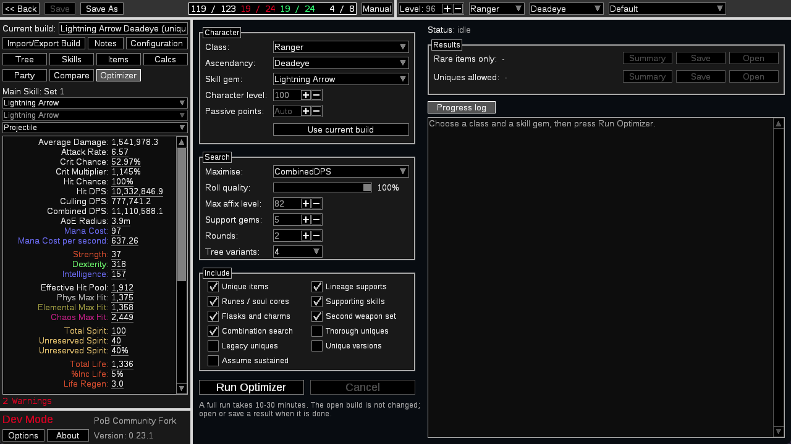
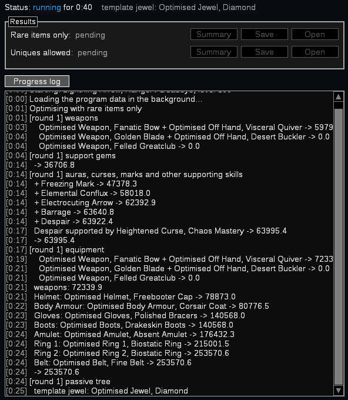
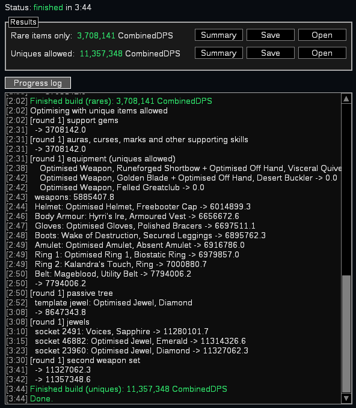
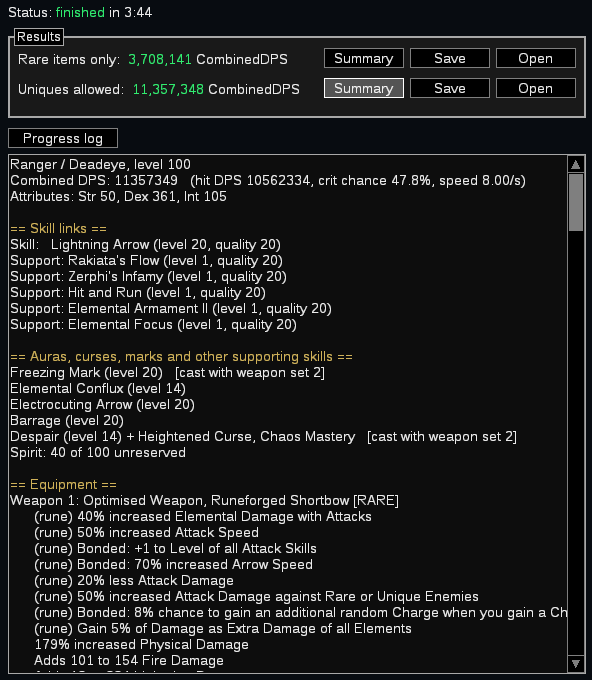

# Build Optimizer

The build optimizer builds a character around one skill gem and searches for the setup with the
most damage. You pick a class, an ascendancy and a skill; it decides:

* the support gems linked to the skill,
* the auras, curses, marks and other skills whose buff or debuff raises the main skill's damage,
* the equipment: crafted rares, and in a second build also the unique items,
* the passive tree, including ascendancy nodes and jewel sockets,
* the jewels in those sockets, and the runes / soul cores in item sockets,
* flasks and charms, where they add damage,
* the second weapon set: swap weapons and weapon-set passives for the supporting skills.

Every candidate is scored by the program's normal calculations, so the DPS the optimizer reports is
exactly the DPS the program shows when you open the result.

**Contents:** [Quick start](#quick-start) · [Settings](#settings) · [Example run](#example-run) ·
[Command line](#command-line) · [How the search works](#how-the-search-works) ·
[What the optimizer does not know](#what-the-optimizer-does-not-know) · [Limitations](#limitations)

## Quick start

1. Open any build (a new one is fine) and press **Optimizer** in the side bar, next to *Compare*.
2. Choose the **class**, **ascendancy** (*Auto* compares all ascendancies of the class) and the
   **skill gem**. Open the skill list and type to search. *Use current build* fills these from the
   build that is open.
3. Leave the rest at the defaults, or see [Settings](#settings). For a first look, set
   *Rounds* and *Tree variants* to 1 and untick *Combination search*: that run takes 3-4 minutes
   instead of 10-30.
4. Press **Run Optimizer**.



The search runs in the background, in its own copy of the program, so you can keep using the
window. Your open build is never changed. The progress log shows each step and the damage after it:



Two builds come out of a run: one with **rare items only** (crafted rares, easy to approximate with
gear you buy), and one with **unique items allowed**, which starts from the rare build. Each row
under *Results* has three buttons:

* **Summary** shows the build as text: links, supporting skills, every item with its modifiers, the
  tree, jewels, which Configuration conditions would add damage, and what the engine can't evaluate.
* **Save** writes it to your builds folder as `<skill> <ascendancy> (rares).xml` / `(uniques).xml`.
* **Open** opens it in the window. If the open build has unsaved changes, you are asked first.




Results and settings stay until the next run or a restart, also after you open one of the
results. *Cancel* stops a run. The background copy of the program needs about 1 GB of memory on
top of the window.

## Settings

Every setting of the Optimizer tab has a command-line equivalent (see [Command line](#command-line)).

| In the Optimizer tab | Command line | What it does |
| --- | --- | --- |
| Class / Ascendancy | `--class`, `--ascendancy` | *Auto* / leaving out `--ascendancy` builds every ascendancy of the class and keeps the best |
| Skill gem | `--skill` | The active skill the build is made for |
| Character level | `--level` | Level of the character (default 100); limits gem levels, items and passive points |
| Passive points | `--points` | Points to spend; empty = everything available at the level |
| Maximise | `--metric` | Calculation output to maximise: `CombinedDPS` (default; includes damage over time and minions), `TotalDPS`, `FullDPS`, ... |
| Roll quality | `--roll <0..1>` | Roll of crafted affixes and unique modifiers; 100% / `1` is a perfect roll, 50% / `0.5` an average one |
| Max affix level | `--item-level` | Highest affix tier level that may be crafted (default 82) |
| Support gems | `--supports` | Number of supports linked to the skill (default 5) |
| Rounds | `--rounds` | Passes over the whole search (default 2); later rounds let earlier choices react to later ones |
| Tree variants | `--tree-width <1-4>` | Number of differently-minded passive trees that are built and compared (default 4) |
| Unique items | `--no-uniques` (off) | Also make the build with unique items allowed |
| Lineage supports | `--no-lineage` (off) | Allow lineage support gems |
| Runes / soul cores | `--no-runes` (off) | Fill item sockets with the best runes / soul cores |
| Supporting skills | `--no-aux` (off) | Add auras, curses, marks and other skills that raise the main skill's damage |
| Flasks and charms | `--no-flasks` (off) | Equip flasks and charms where they add damage |
| Second weapon set | `--no-weapon-sets` (off) | Use weapon set 2 and its passives for the supporting skills |
| Combination search | `--no-combos` (off) | Look for supports, affixes and passives that only work together (slower) |
| Thorough uniques | `--thorough` | Try every unique as one half of a unique pair (adds several minutes) |
| Legacy uniques | `--legacy-uniques` | Also try older versions of uniques ("Pre 0.4.0") and uniques that are no longer obtainable |
| Unique versions | `--unique-variants` | Also try every version of uniques that come in several, e.g. Cursecarver's curse, From Nothing's keystone or Darkness Enthroned's slot (slower, see below) |
| Assume sustained | `--assume sustained` | Switch on the Configuration conditions the build keeps up by itself (see [Configuration](#configuration)) |

**Which uniques take part.** By default the unique search only uses what can be found in the game
now: uniques marked "No longer obtainable" (the same rule as the *Obtainable* filter of the unique
list) and older versions are left out, and each unique is tried in the version the unique list shows.
Test variants, such as From Nothing's "Everything", are never used.

* *Legacy uniques* adds the older versions and the unobtainable uniques. The summary marks a
  legacy item, e.g. `Ab Aeterno, Grand Cuisses [UNIQUE] (legacy version: Pre 0.4.0)`.
* *Unique versions* tries every current version of uniques with one choice, and the summary names
  the version that won, e.g. `Voices, Sapphire [UNIQUE] (version: 4 Sinister Sockets)`. Uniques
  where several choices are made at once (Megalomaniac's notables, Mageblood's Legacies, Grip of
  Kulemak's modifiers) keep the selection of the unique list. Trying their first choice alone is no
  real search, and their hundreds of variants would each be a full item.

## Example run

Lightning Arrow, Ranger / Deadeye, level 100, with *Rounds* 1, *Tree variants* 1 and no combination
search; everything else at the defaults. The progress log (command line output; the Optimizer tab
shows the same lines) starts like this:

```
[   0.1s] Optimising with rare items only
[   0.1s] [round 1] weapons
[   2.3s]     Optimised Weapon, Fanatic Bow + Optimised Off Hand, Visceral Quiver -> 5979.6
[   3.6s] [round 1] support gems
[  18.0s]   -> 36706.8
[  18.0s] [round 1] auras, curses, marks and other supporting skills
[  18.1s]   + Freezing Mark -> 47378.3
[  18.2s]   + Elemental Conflux -> 58018.0
[  18.3s]   + Electrocuting Arrow -> 62392.9
[  18.4s]   + Barrage -> 63640.8
[  18.5s]   + Despair -> 63922.4
[  22.8s] [round 1] equipment
[  28.5s]   Helmet: Optimised Helmet, Freebooter Cap -> 78873.0
[  30.7s]   Gloves: Optimised Gloves, Polished Bracers -> 140568.0
[  32.5s]   Ring 2: Optimised Ring 2, Biostatic Ring -> 253570.6
[  32.9s] [round 1] passive tree
[ 135.0s]   -> 3340210.0
[ 135.0s] [round 1] jewels
[ 147.9s]   socket 60735: Optimised Jewel, Diamond -> 3719647.8
[ 147.9s] [round 1] second weapon set
[ 163.8s] Rare-only build: 3708142 (80941 calculations)
```

Each `[round 1] ...` line starts a stage; the lines under it are the choices made there with the
score after them, and a bare `-> number` is the score at the end of the stage. (The time is the
processor time of the search; the Optimizer tab shows the elapsed time instead.) The unique build
then starts from the rare one:

```
[ 213.0s] [round 1] equipment (uniques allowed)
[ 233.0s]   Body Armour: Hyrri's Ire, Armoured Vest -> 6656672.6
[ 236.4s]   Boots: Wake of Destruction, Secured Leggings -> 6895762.3
[ 238.4s]   Ring 2: Kalandra's Touch, Ring -> 7000880.7
[ 238.7s]   Belt: Mageblood, Utility Belt -> 7794006.2
[ 239.2s] [round 1] passive tree
[ 264.3s]   -> 8647343.8
[ 264.3s] [round 1] jewels
[ 268.1s]   socket 2491: Voices, Sapphire -> 11280101.7
[ 311.0s] Build with uniques: 11357349 (34846 calculations)
```

The summary of the unique build, shortened (`...` marks left-out lines):

```
Ranger / Deadeye, level 100
Combined DPS: 11357349   (hit DPS 10562334, crit chance 47.8%, speed 8.00/s)
Attributes: Str 50, Dex 361, Int 105

== Skill links ==
Skill:   Lightning Arrow (level 20, quality 20)
Support: Rakiata's Flow (level 1, quality 20)
Support: Zerphi's Infamy (level 1, quality 20)
Support: Hit and Run (level 1, quality 20)
Support: Elemental Armament II (level 1, quality 20)
Support: Elemental Focus (level 1, quality 20)

== Auras, curses, marks and other supporting skills ==
Freezing Mark (level 20)   [cast with weapon set 2]
Elemental Conflux (level 14)
Electrocuting Arrow (level 20)
Barrage (level 20)
Despair (level 14) + Heightened Curse, Chaos Mastery   [cast with weapon set 2]
Spirit: 40 of 100 unreserved

== Equipment ==
Weapon 1: Optimised Weapon, Runeforged Shortbow [RARE]
      179% increased Physical Damage
      Adds 101 to 154 Fire Damage
      Adds 12 to 234 Lightning Damage
      ...
Body Armour: Hyrri's Ire, Armoured Vest [UNIQUE]
      ...
Belt: Mageblood, Utility Belt [UNIQUE]
      ...

== Passive tree ==
Points: 123 passive, 4 ascendancy, 5 jewel sockets
Ascendancy notables: Projectile Proximity Specialisation
Notables (23): Acceleration, Catalysis, Clean Shot, Cooked, Cull the Hordes, Falcon Dive, ...

== Jewels ==
Socket 2491: Voices, Sapphire [UNIQUE] (version: 4 Sinister Sockets)
      ...

== Configuration ==
No conditions are assumed beyond the defaults of a new build.
Conditions that would raise the damage if you can keep them up (--config <name>=true, or <name>=<number> for counts):
  Is the enemy Critically Weak                          +89.2%   [conditionEnemyCriticalWeakness]
  Do you have Adrenaline?                               +21.8%   [buffAdrenaline]
  Is the enemy Shocked?                                 +17.2%   [conditionEnemyShocked]
  ...

== Strong options the engine could not fully evaluate ==
Boots: Ab Aeterno, Grand Cuisses — readable part alone: -2.7% vs current
      Your speed is Unaffected by Slows while Sprinting
The Spring Hare (Notable, 4 points away) — readable part: +3.2%
Inexorable Critical I — readable part as a sixth link: +14.1%; stats without a calculation: supported_by_inevitable_criticals
...

== Parts of this build the engine does not calculate ==
Boots (Wake of Destruction, Secured Leggings): Drop Shocked Ground while moving, lasting 8 seconds
Ring 2 (Kalandra's Touch, Ring): Reflects opposite Ring
...
```

The last three sections are worth a look before you play the build. *Configuration* lists the
conditions the number does **not** assume yet: here keeping the enemy Critically Weak would add 89%.
The other two list what the engine can't calculate (see
[What the optimizer does not know](#what-the-optimizer-does-not-know)).

The same example with and without *Unique versions*:

| Settings | Rare build | Unique build | Calculations (unique build) |
| --- | --- | --- | --- |
| As above | 3,708,142 | 11,357,349 | 34,846 |
| As above + *Unique versions* | 3,708,142 | 11,625,121 (+2.4%) | 35,643 |

With *Unique versions* the search found Prism of Belief in its "Lightning Arrow" version (extra
levels of the main skill), which the default search never sees. In the Optimizer tab the first run
took 3:44 on a 16-core desktop. Expect *Unique versions* to cost more for builds that try many
jewels with long version lists.

## Command line

The optimizer also runs without the window through `src/OptimizeBuild.lua`. On Windows no Lua
installation is needed: `OptimizeBuild.py` runs the script in the LuaJIT that ships in `runtime/`,
and also writes an import code for every saved build. From the `src` directory:

    python OptimizeBuild.py --class Ranger --ascendancy Deadeye --skill "Lightning Arrow" --out ../builds

or with LuaJIT:

    luajit OptimizeBuild.lua --class Ranger --ascendancy Deadeye --skill "Lightning Arrow" --out ../builds

Two builds are produced, `<name> (rares).xml` and `<name> (uniques).xml`, each with a `.txt`
summary. Copy the `.xml` into the build folder, or paste the contents of the `.code.txt` into
*Import/Export Build -> Import from website or code*.

All settings of the [table above](#settings) are available; `--help` lists everything. Options that
only exist on the command line:

| Option | Meaning |
| --- | --- |
| `--jobs <n>` | Processes to use (default 3); the extra ones build tree variants in parallel (about 1 GB each) |
| `--config key=value` | Any Configuration tab input, e.g. `--config enemyIsBoss=Pinnacle` |
| `--assume a,b,c` | Switch on the named Configuration conditions |
| `--gem-level <n>` | Level of the skill gem (default: the highest the character can use) |
| `--only-uniques` | Only save the build with uniques |
| `--out <dir>`, `--name <text>` | Where to save the builds, and their base name |
| `--coverage` | Print how much of the program's data the engine can't calculate, and exit |
| `--quiet`, `--debug` | Less / more output |

A full run takes roughly ten minutes. The script stops itself with a stack dump if its memory passes
3 GB or it reports no progress for 15 minutes (`POB_OPTIMIZER_MEMORY_MB`, `POB_OPTIMIZER_SILENCE_S`).

To try several variants at once, put one line of arguments per variant in a text file (optionally
starting with `name=<text>`) and run `python OptimizeBuild.py --batch variants.txt --out <dir>`.
The variants run in parallel, as many as the physical cores and free memory allow (about 1 GB each;
`--parallel <n>` overrides), and `batch-results.txt` ranks them. Seven variants took 18 minutes on an
8-core machine, against about an hour one after another.

With plain LuaJIT, parallel workers need to know how to start another copy of the script:
set `POB_OPTIMIZER_WORKER`, e.g. to `luajit OptimizeBuild.lua`. The Python launcher does this itself.

### From Lua

```lua
local optimizer = LoadModule("Modules/BuildOptimizer")
optimizer.SetupCharacter(build, { class = "Ranger", ascendancy = "Deadeye", skill = "Lightning Arrow", level = 100 })
local result = optimizer.Optimize(build, { allowUniques = false })   -- options: optimizer.defaultOptions
print(result.score, optimizer.Describe(build))
```

`Optimize` works on the build in place and only ever accepts changes that raise the score, so it can
be called again on its own result (this is how the unique build is derived from the rare one). The
Optimizer tab runs the same calls in a background subscript (`src/OptimizerSubScript.lua`).

## How the search works

The space of builds is far too large to enumerate, and the stats interact (more/increased/added
damage, crit chance vs. crit damage, conversion), so the optimizer runs a sequence of greedy and
local-search passes, each scored exactly, and repeats the sequence so that earlier choices can react
to later ones:

1. **Weapon bootstrap** - attacks deal no damage unarmed, so a weapon is found first if needed.
2. **Support gems** - the links are filled greedily with the support that adds the most, then every
   link is swapped for a better one until nothing improves. Because a greedy fill can lock itself in
   (a support that is only good alone, or only in combination), the fill is restarted from the
   best few single supports and the best final set of links is kept. Supports of the same family are
   never combined.
3. **Supporting skills** - every skill gem with an effect beyond its own damage (persistent buffs,
   curses, marks, ...) is tried as an extra skill, and the one that adds the most is kept, until
   nothing helps or the skill slots are full. Each of them then gets the supports that raise the
   score, such as more curse effect. The engine applies the curse limit; one mark at most is
   allowed. A build that reserves more Spirit than it has scores as invalid everywhere, and a buff
   that only fails on Spirit gets one chance: the body armour or amulet is crafted again with the
   buff in place, which makes a Spirit affix worth its slot.
4. **Equipment** - for every slot the usable bases are ranked by evaluating them bare; the best base
   of each promising item type is then crafted. Crafting adds, one at a time, the highest eligible
   tier of whichever affix raises the score the most, respecting prefix/suffix limits, modifier
   groups and spawn weights, the same rules the "Craft item" dialog uses. Sockets are filled with the
   best runes. Main hand and off hand are searched as pairs so that a two-hander competes fairly
   with a one-hander plus quiver, focus, shield or second weapon. With uniques allowed, every unique
   that fits the slot competes with the crafted rare. Only uniques that can be found now take part,
   in their current version: uniques marked "No longer obtainable", older versions ("Pre 0.4.0")
   and test variants are left out (`--legacy-uniques` / *Legacy uniques* adds the first two), and a
   unique that comes in several versions is tried in the one the unique list selects
   (`--unique-variants` / *Unique versions* tries all of them; see [Settings](#settings)). Flask and charm slots are switched on and get
   the magic or unique item that adds the most; slots where nothing helps stay empty.
5. **Passive tree** - ascendancy points first, then the main tree. The main tree is built several
   times, each time ranking candidates by gain / cost ^ exponent with a different exponent (1 is
   plain value per point, lower values accept more travel to reach a strong cluster), and the best
   tree is kept; these builds run in parallel worker processes when `--jobs` allows. Each step values every reachable
   node on its own, estimates from that the value per point of whole paths and of whole clusters
   (all useful nodes of a group plus the travel to reach them), verifies the most promising
   candidates with a real calculation and allocates the best. Jewel sockets hold a jewel crafted for
   the build while this runs, so a socket is worth what can be put into it. Afterwards a local
   search repeatedly gives back the least valuable branch and lets the allocation spend the points
   again, keeping the result only when the build improves.
6. **Jewels** - every allocated socket gets its own jewel crafted in place, which is what lets
   Time-Lost jewels be judged by the passives actually in their radius.
7. **Second weapon set** - the main skill stays in set 1. Supporting skills that are cast (curses,
   marks, offerings; not persistent buffs) move to set 2 where that costs nothing, the swap weapon
   slots get the items that add the most (for example "+ to Level of all Minion Skills" for an
   offering), and passives that only serve the main skill are turned into set 1 passives, which
   frees the same number of points for set 2 passives. All of it is undone if the build isn't better.
8. **Attributes** - the allocated attribute nodes are set to meet the requirements of gems and gear,
   and otherwise to whichever attribute scores best. Supporting gems whose requirements still can't
   be met are lowered in level, or dropped.

### Minions

The engine reports the damage of one minion; the gem's "Count" only decides how much Spirit is
reserved. For minions that reserve Spirit per minion, the optimizer scores the per-minion damage
times the number of minions the remaining Spirit can pay for and keeps the gem count in step, so
Spirit, reservation efficiency and buffs that cost Spirit are all weighed against more minions.

### Configuration

Damage depends on the Configuration tab. By default nothing is assumed beyond a new build's
defaults. `--assume sustained` switches on the conditions a build keeps up just by using its skill,
each decided by the build's own numbers (enemy shocked/ignited/chilled/bleeding/poisoned at 20% or
more chance per hit, crit recently at 20% or more crit chance, and so on;
`optimizer.sustainedConditions`), keeps the ones that help, and runs another round so the build can
grow around them. `--assume name,name` does the same for conditions you name. Every summary ends
with what each remaining yes/no condition would be worth, so you can see what the number rests on
and what is left on the table. The configuration report also covers count options (stacks, charges or
uses "recently"), showing the change at 1, 5 and 10. Set one with `--config <name>=<number>`.

### Combinations whose parts do nothing alone

A greedy search only ever adds things that help immediately, so it is blind to two modifiers that
are each worthless without the other. Testing all pairs is far too slow, so the optimizer uses
group testing: everything that did nothing on its own is applied at once. If the build doesn't
move, no combination among those things matters and one calculation has ruled them all out. If it
does move, the group is cut down by repeated halving to the few members that are responsible, and
those are offered to the search as a single candidate. This is done for

* support gems (on an empty skill, and on top of the best links found),
* affixes on every crafted item and jewel (after first re-testing each idle affix next to the ones
  already chosen),
* passive nodes, at every step of the tree allocation, including the ascendancy.

Uniques can't be applied all at once, so pairs of uniques are searched directly: for the leading
rejected uniques of every slot (`--thorough`: every unique), the unique is put on and every unique in
every other slot is tried next to it.

The pipeline is repeated, which is what connects the stages: a support that only pays off with a
certain affix, or a passive that needs a unique, is picked up in the next round as long as one side
of the pair is worth something by itself.

## What the optimizer does not know

There are no hard-coded build recipes. A unique interaction or skill setup is found if, and only
if, the calculation engine models it and its effect shows up in the optimised stat. In practice:

* Mechanics marked "Not supported in PoB yet" are worth nothing to the search. Every summary lists
  the unsupported lines of that build, and `--coverage` prints the totals: at the time of writing
  about half of the unique items, a fifth of the notables, ascendancy passives and runes, and 30% of
  the keystones have at least one modifier the engine can't read.
* Conditional effects count only if their condition is on in the Configuration tab.
* Setups that depend on how a skill is played (combos, detonating one skill with another, charges
  generated by a second skill) are not modelled beyond what the engine assumes by default.

### Seeing the blind spots

Every build summary has a section "Strong options the engine could not fully evaluate". It lists:

* unique items whose readable modifiers alone come within 25% of the current item in that slot, and
  that have at least one unreadable line that looks damage-related;
* notables, keystones and ascendancy passives within 8 points that have unreadable lines that look
  related to damage or to the main skill's tags, with what their readable part is worth;
* support gems that have a stat without a calculation, and whose readable part is within 3% of the
  build, as a sixth link.

"Looks damage-related" is a keyword match, so the list has false positives. It is a list of things to
check by hand, not a ranking.

`optimizer.BlindSpotReport(build, options)` returns the same text from Lua.

## Engine additions on this branch

The branch also teaches the calculation engine a first batch of modifiers it could not read. They
follow the engine's usual pattern of a parser entry plus a Configuration option, so they do nothing
until the matching option is set.

* Charges consumed recently: "per Endurance/Frenzy/Power Charge consumed Recently"
  (`multiplierEnduranceChargesConsumedRecently`, `multiplierFrenzyChargesConsumedRecently`,
  `multiplierPowerChargesConsumedRecently`).
* Glory: attack damage per Glory consumed, with its cap (`multiplierGloryConsumedRecently`), and
  modifiers per use of a skill that requires Glory (`multiplierGlorySkillsUsedRecently`).
* Elemental Infusions: damage "if you've collected a Fire/Cold/Lightning Infusion in the last 8
  seconds" (`conditionCollectedFireInfusionRecently` and the Cold/Lightning equivalents).
* Skill variety: modifiers "for each different" Spell, non-instant Attack, Warcry or Command Skill
  used recently (`multiplierDifferentSpellsCastRecently`, `multiplierDifferentAttacksUsedRecently`,
  `multiplierDifferentWarcriesUsedRecently`, `multiplierDifferentCommandSkillsUsedRecently`).
* Aftershocks: chance for Slam skills to cause an additional Aftershock now counts as that many more
  hits per use for Slam skills. Skills that model their Aftershock as a separate part (such as
  Earthquake) are left alone. This is the one change to the damage calculation itself
  (`CalcOffence.lua`). It rests on the assumption that an Aftershock repeats the Slam's hit, which
  has not been checked in game.
* Smaller parser additions: more sources of Critical Weakness, exposure applied on critical hit / on
  shocking / on igniting (these unlock the engine's existing "enemy is exposed" options), attacks'
  added Chaos damage from maximum Life, extra damage for Empowered Attacks, damage against targets in
  your Presence, and one Mace conversion line.

Measured with `--coverage`, this moved unsupported notables from 221 to 207 and unsupported unique
items from 215 to 210. Most remaining gaps are mechanics (Combo generation, Archon, Volatility,
triggers and Invocation, Concentration, charge generation) rather than missing phrases.
`Data/ModCache.lua` was regenerated with `REGENERATE_MOD_CACHE=1`; the new behaviour is covered by
`spec/System/TestRecentlyConsumed_spec.lua`.

## Limitations

* The result is a strong build, not a proven optimum. Combinations are found within one kind of
  choice (supports, affixes of one item, passives, pairs of uniques). A combination of two things
  of different kinds that are both worthless alone, or of three or more uniques, can still be missed,
  as can a keystone that hurts on its own and only pays off after the build is changed around it.
* Only damage is optimised. Slots that can't add damage are left as an item base without
  modifiers, and life, resistances and other defences are ignored; treat those slots as free room
  for defensive stats.
* Damage depends on the Configuration tab (enemy type, charges, conditions such as "enemy is
  shocked"). The defaults of a new build are used unless `--config` says otherwise.
* Buffs, curses, marks, flasks and charms are counted as permanently active, the way the engine
  treats an enabled skill or flask. Skills that are counted for a short-lived effect (for example a
  buff that applies to the next attack) make the number an upper bound rather than a sustained
  figure; use `--no-aux` to see the build without them.
* Crafted items are "best case" items: any combination of top-tier affixes at the chosen roll
  quality. Lower `--roll` and `--item-level` for something closer to what can be bought.
* Item choice doesn't take attribute requirements into account. They are met afterwards with
  attribute nodes where possible, and the summary flags any requirement that is left unmet.
* The second weapon set is only used for supporting skills; a second damage skill with its own
  set, and swapping for a skill rotation, are not searched.
* For skills the engine displays by average hit instead of DPS (for example Rolling Slam), the
  optimised number is the average hit, so attack speed and Aftershocks do not change it. Use
  `--metric TotalDPS` to optimise hit DPS for those.

## Ideas for going further

* **Defensive constraints** - require minimum life, resistances or effective hit pool, and spend the
  affix slots the damage search leaves empty on them.
* **Negative-first choices** - try keystones and uniques that lower the score on their own by
  re-running the following stages with them forced in.
* **Cross-kind combinations** - extend the group test across kinds, e.g. idle supports together with
  idle passives.
* **More in parallel** - only the tree variants run in worker processes; whole-pipeline restarts
  and item crafting could be spread out the same way.
* **Skill rotations** - a second damage skill in the second weapon set, scored with Full DPS.
* **Exact tree connection** - solving the "connect these notables as cheaply as possible" sub-problem
  exactly (a Steiner tree) instead of following shortest paths one target at a time.
